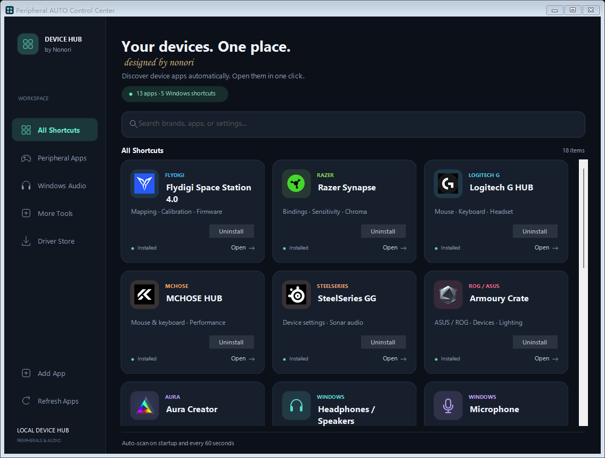
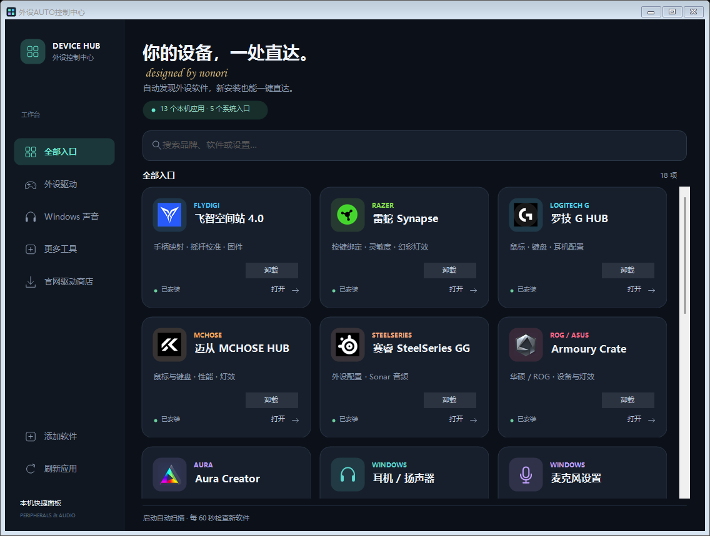
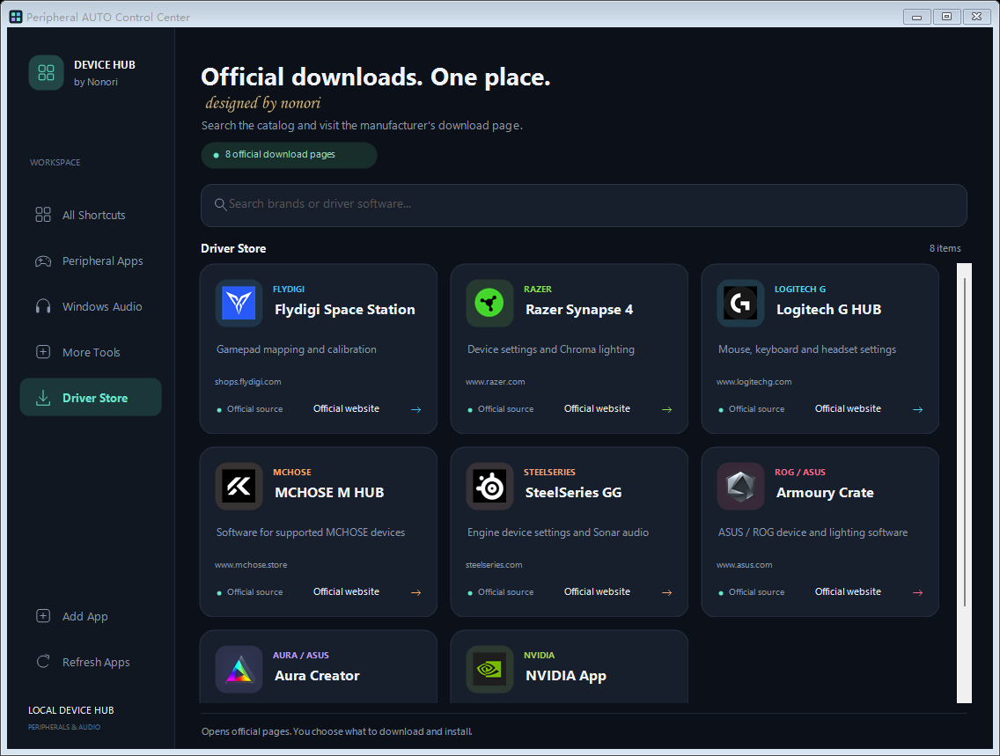

# Peripheral AUTO Control Center | 外设AUTO控制中心

**By Nonori · Windows desktop utility · v2.2.0 · English & 简体中文**

Your peripheral apps and Windows audio settings, together in one launcher. Spend less time searching the Start Menu and more time getting your setup ready to play.

把外设管理软件、耳机和麦克风设置集中到一个窗口。中英文版本功能一致，选择你习惯的界面即可。

**[中文使用指南](README.zh-CN.md)** · **[Release notes / 更新说明](RELEASE-v2.2.0.md)** · **[Report a problem / 反馈问题](https://github.com/hoootpot002-code/Peripheral-AUTO-Control-Center/issues)**

## Choose your edition | 选择版本

| Download | Interface | Best for |
| --- | --- | --- |
| [English EXE](https://github.com/hoootpot002-code/Peripheral-AUTO-Control-Center/releases/download/v2.2.0/Peripheral-AUTO-Control-Center-EN.exe) | English | Players who prefer an English interface |
| [中文版 EXE](https://github.com/hoootpot002-code/Peripheral-AUTO-Control-Center/releases/download/v2.2.0/Peripheral-AUTO-Control-Center-ZH-CN.exe) | 简体中文 | 习惯中文界面的玩家 |

**Just download one EXE and double-click it. No installer required.** Both editions have the same features and share your manually added shortcuts on the same Windows account. Switching language means opening the other EXE; there is no in-app language switch.

只需要下载一个对应语言的 EXE。要换语言，运行另一个版本即可，无需重新添加手动保存的入口。

## Take a look | 界面预览

### English edition



### 简体中文版



Screenshots show apps found on the development PC. Your list depends on what is installed on your own computer.

截图里的软件数量仅作展示，实际入口会根据你的电脑扫描生成。

## Get started in three steps | 三步上手

1. **Open the launcher.** It scans for installed companion apps at startup.
2. **Click a card.** Open your device app, headphones, microphone, or another audio page.
3. **Install something new?** Click **Refresh Apps / 刷新应用**, or leave the window open for the next automatic check, every 60 seconds. If an app is missed, use **Add App / 添加软件** and select its EXE or shortcut.

下载运行 → 点击对应卡片 → 新装软件后刷新；没识别到的入口可以手动添加。

## Everyday uses | 适用场景

- Open a mouse companion app to change sensitivity or button bindings before a game.
- Jump to a controller app to adjust mappings or calibration using the vendor's tools.
- Open your default headphones or microphone properties before joining voice chat.
- Reach the Windows volume mixer when one game or chat app is too loud.

The launcher opens the appropriate app or settings page. You make the actual changes there.

本工具负责快速打开设置入口，具体的参数调整仍在品牌软件或 Windows 设置中完成。

## What it does | 功能

- **Automatic app discovery:** reads Start Menu shortcuts, current-user and public desktop shortcuts, installed-program records, and the Windows application list.
- **Original application icons:** displays the app's own icon when available; otherwise uses a generic icon.
- **Correct shortcut arguments:** preserves launch arguments required by companion apps.
- **Refresh and cleanup:** checks at startup and every 60 seconds while open, merges duplicate entries, and drops entries that can no longer be found.
- **Manual additions:** adds apps that automatic detection misses and saves them for your next launch.
- **Search and categories:** finds apps by name or brand and separates peripheral apps, Windows audio, and other tools.
- **English and Chinese builds:** localized controls, app descriptions, prompts, and application messages.
- **Direct uninstall:** the small gray Uninstall button above Open asks for confirmation, then starts the registered vendor uninstaller. Windows app packages are removed for the current account through Windows package management.
- **Driver Store:** a separate sidebar page searches eight curated official download pages. Each card shows the manufacturer domain and opens that page in your default browser.

## Uninstall apps | 直接卸载

Click **Uninstall / 卸载**, check the software name, and confirm. This actually uninstalls software. It does not simply hide a shortcut. Vendor uninstallers may ask for administrator approval, offer component choices, or request a restart. Cancelling our confirmation starts nothing.

Uninstall is disabled when no unique, usable registered command can be matched. Windows settings cards have no uninstall action. The launcher never deletes program folders or driver files itself. For Windows app packages, removal applies only to the current user; related vendor services and other separately installed components may remain.

The card remains until a refresh can no longer find the app. Complete the vendor wizard, then click **Refresh Apps**, or wait for the 60-second scan while the launcher is open. An interrupted uninstall or a leftover launchable app can keep an entry visible; the tool does not claim removal succeeded merely because it started a process.

小灰框会启动实际卸载流程。无法可靠匹配卸载信息时不可用；系统设置卡片不会显示卸载按钮。卸载完成后刷新列表，软件不会在点击后立刻被当作已卸载。

## Official Driver Store | 官网驱动商店



Search by brand or software name, including common Chinese and English keywords. This searches the included directory, not the entire web. The initial catalog contains Flydigi Space Station, Razer Synapse 4, Logitech G HUB, MCHOSE M HUB, SteelSeries GG, Armoury Crate, Aura Creator, and NVIDIA App. Armoury Crate and Aura Creator share the ASUS installer page.

**Official website / 官网下载** opens a manufacturer page; you select the package for your model and download it in the browser. The launcher does not download, install, or update software in the background. Browsing the catalog does not need administrator permission; installing or uninstalling software may need it. Publisher pages may change later. The recorded source URLs and check date are in [OFFICIAL-SOURCES.md](OFFICIAL-SOURCES.md).

官网商店提供已核实的品牌页面入口，不代替你选择驱动型号。新装软件仍由现有自动扫描机制发现。

### Windows audio shortcuts

| Shortcut | Opens |
| --- | --- |
| Headphones / Speakers · 耳机 / 扬声器 | Current default output device properties |
| Microphone · 麦克风设置 | Current default input device properties |
| Sound & Devices · 声音与设备 | Windows sound settings and device selection |
| Volume Mixer · 应用音量混合器 | Per-app volume controls |
| Microphone Privacy · 麦克风权限 | Windows microphone access settings |

## Requirements and scope | 运行要求与识别范围

- Intended for **Windows 11** with **.NET Framework 4.x** installed. No separate .NET SDK is needed to run the EXE.
- Install your device vendor's software first. This launcher does not download or install it for you.
- Detection uses brand names, application names, publishers, and product descriptions. It covers many common peripheral utilities, but cannot guarantee detection of every product.
- Portable apps without registered entries or shortcuts, and apps with unclear metadata, may need manual addition.
- A driver with no separate management interface is not a launchable app. Background services, uninstallers, updaters, and firmware tools are filtered out.
- Windows pages and vendor apps retain their own language. An English launcher does not translate other programs or rename an unknown app's installed display name.

支持常见外设管理软件，但不承诺识别全部品牌；底层驱动文件不会单独显示为可打开的应用。

## FAQ | 常见问题

**I installed a new app. Where is it?** Click Refresh Apps. If it is still missing, use Add App and select the app's normal EXE or Start Menu shortcut. Choosing the shortcut is useful when the app needs launch arguments.

**Does it scan while closed?** No. The automatic 60-second check runs only while the launcher is open. It also scans when you start it again.

**The wrong audio device opens.** The headphones and microphone cards follow the Windows default devices. Use Sound & Devices to select or manage another device.

**Does it change my drivers or gaming performance?** It opens app/settings pages, starts an uninstaller only after your confirmation, and links to official download pages. It does not update drivers, flash firmware, adjust settings automatically, or promise FPS improvements. A vendor uninstaller may remove components belonging to the app you choose to uninstall.

**Can I use both languages?** Yes. Each has the same features and reads the same saved custom-app list. Windows file dialogs and system messages may still follow your Windows language.

## Local data | 本地数据

Discovery runs on your PC. The application does not upload the scanned app list or contain an in-app telemetry service.

Custom entries are saved in `%LOCALAPPDATA%\PeripheralHub\custom-apps.xml`; the folder is created when you add an app. Closing the launcher stops its periodic scans.

扫描结果在本机处理；中英文版本共用同一份手动添加记录。

## Community feedback | 社区反馈

Please use [GitHub Issues](https://github.com/hoootpot002-code/Peripheral-AUTO-Control-Center/issues) for a missed app, an incorrect shortcut, a translation issue, or a layout problem. Include the app name and version, your Windows version, the launcher edition, and what you expected versus what happened. A screenshot with personal details hidden is helpful.

反馈时说明“软件名称 / 版本、Windows 版本、中文或英文界面、具体问题”即可。欢迎玩家提出缺失的软件和翻译改进建议。

## Build from source

On Windows, run in PowerShell:

```powershell
.\build.ps1                    # Build both editions
.\build.ps1 -Language en-US    # English only
.\build.ps1 -Language zh-CN    # 简体中文 only
```

Outputs are written to `dist/`. The script uses the Windows .NET Framework C# compiler; no NuGet downloads are required.

| File | Purpose |
| --- | --- |
| `PeripheralHub.cs` | Interface, launch actions, and Windows settings shortcuts |
| `PeripheralDiscovery.cs` | App discovery, filtering, deduplication, and custom entries |
| `UiLocalization.cs` | English translations and language-specific labels |
| `AppManagement.cs` | Uninstall registrations, matching, confirmation, and current-user package removal |
| `DriverStore.cs` | Curated manufacturer pages and strict HTTPS/domain validation |
| `PeripheralHub.manifest` / `PeripheralHub.ico` | Windows manifest and application icon |
| `Nonori.Signature.png` | Embedded calligraphic signature, consistent across PCs |
| `build.ps1` | Build one or both editions |

## Validation

Both editions passed checks for simulated installation of an unknown-brand app through a real shortcut, icon loading, launch-argument preservation, repeated scans, missing-entry removal, custom-entry persistence, search, filtering, and compact layouts. English labels and both interface layouts were also checked. Automated checks did not launch external vendor apps and do not establish compatibility with every peripheral.

v2.2.0 also checks uninstall-command parsing, ambiguous-match rejection, cancelled confirmation and cancelled elevation, registered command routing, current-user package scope, eight official-page routes, and store search. A fake process dispatcher captures commands: no real installed app was uninstalled, and no installer was downloaded or run. Vendor uninstall completion still needs real-world validation when the user chooses to uninstall an app.

Brand names and icons belong to their respective owners. This project is independent and is not affiliated with device manufacturers.

**Creator / 发布者: Nonori**

