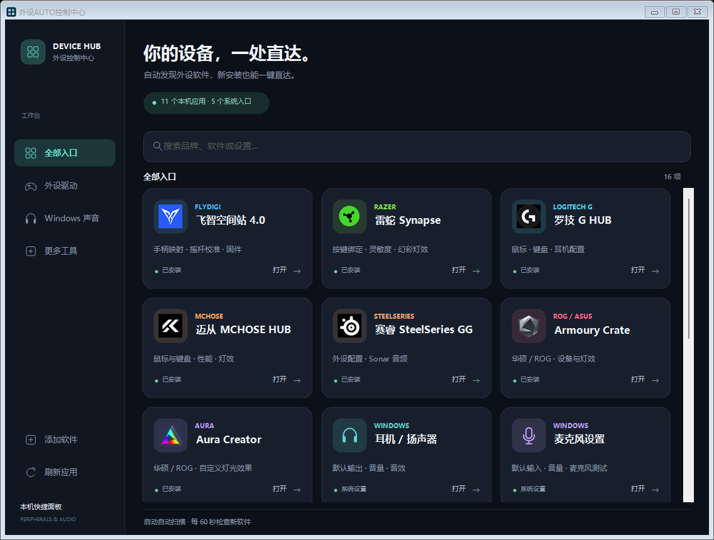

# 外设AUTO控制中心 | Peripheral AUTO Control Center

**发布者：Nonori · v2.1.0 · 中文 / English**

[English overview](README.md) · [下载最新版本](https://github.com/hoootpot002-code/Peripheral-AUTO-Control-Center/releases/latest) · [反馈问题](https://github.com/hoootpot002-code/Peripheral-AUTO-Control-Center/issues)

一个面向普通玩家的 Windows 外设快捷面板：把手柄、鼠标、键盘、耳机等设备的管理软件，以及 Windows 声音设置，集中到同一个窗口。

## 下载哪个版本？

| 文件 | 界面语言 |
| --- | --- |
| [Peripheral-AUTO-Control-Center-ZH-CN.exe](https://github.com/hoootpot002-code/Peripheral-AUTO-Control-Center/releases/latest/download/Peripheral-AUTO-Control-Center-ZH-CN.exe) | 简体中文 |
| [Peripheral-AUTO-Control-Center-EN.exe](https://github.com/hoootpot002-code/Peripheral-AUTO-Control-Center/releases/latest/download/Peripheral-AUTO-Control-Center-EN.exe) | English |

选择一个 EXE 下载后双击即可，无需安装本工具。两个版本功能一致，共用当前 Windows 账户的手动添加记录。需要换语言时，打开另一份 EXE 即可；软件内没有语言切换按钮。

## 怎么用？

1. 打开面板，等待自动扫描本机已安装的软件。
2. 点击软件卡片，打开品牌驱动管理界面；点击耳机、麦克风等卡片，直达相应的 Windows 设置。
3. 后续新装外设软件，可以点击“刷新应用”，也可以保持面板打开，等待每 60 秒一次的自动检查。没找到的软件，用“添加软件”选择 EXE 或快捷方式即可。

例如，玩游戏前打开罗技或雷蛇软件调整鼠标，切换飞智手柄映射，或在语音聊天前检查默认麦克风。面板负责打开入口，具体设置由你在原软件里完成。

## 功能说明

- 扫描开始菜单、当前用户及公共桌面、已安装程序记录和 Windows 应用列表。
- 读取软件自带图标；无法读取时显示通用图标。
- 保留快捷方式的启动参数，合并重复入口，移除已经找不到的应用。
- 支持品牌 / 名称搜索和分类浏览。
- 可手动添加漏识别的软件，后续启动继续保留。
- 提供耳机 / 扬声器、麦克风、声音设备、应用音量混合器和麦克风权限入口。

## 运行要求与识别范围

本工具面向 Windows 11，运行需要 .NET Framework 4.x，不需要额外安装 .NET SDK。请先安装设备厂商的软件，本工具不会替你下载或安装驱动。

自动识别依赖品牌、软件名称、发布者及产品说明。大多数常见外设管理软件可以按这些信息识别，但无法保证覆盖所有产品。没有注册信息或快捷方式的便携软件、产品资料不明确的软件，可能需要手动添加。

只有底层驱动、没有独立管理界面的项目，不会作为可打开的应用显示。扫描会过滤后台服务、卸载器、更新器及固件工具。

## 常见问题

**新装的软件没显示怎么办？**

先刷新，再尝试手动添加。优先选择厂商提供的开始菜单快捷方式，可以保留软件要求的启动参数。

**关闭面板后还会自动扫描吗？**

不会。定时检查仅在面板运行期间进行，下一次打开时会重新扫描。

**耳机或麦克风入口打开的不是我要的设备？**

这两个入口跟随 Windows 当前默认的输出、输入设备。需要选择其他设备时，使用“声音与设备”。

**英文版会把其他软件也变成英文吗？**

不会。英文版翻译的是本工具的界面。品牌软件、Windows 设置、系统文件选择窗口和系统错误消息仍跟随各自的语言设置，自动发现的软件也可能保留原来的安装名称。

**它能更新驱动或提高游戏帧数吗？**

它是快捷入口工具，不会自动更新驱动、刷写固件或调整设备参数，也不承诺提升帧数。

## 本地数据与反馈

扫描在本机进行，程序不会上传应用列表，也没有内置遥测服务。手动添加记录保存在 `%LOCALAPPDATA%\PeripheralHub\custom-apps.xml`，添加软件时才会创建该目录。

如果遇到漏识别、打不开、文字翻译或排版问题，可以在 Issues 中告诉我们：软件名称和版本、Windows 版本、使用的界面语言，以及预期与实际表现。截图请遮住不相关的个人信息。

欢迎玩家和社区用户补充遗漏的软件名称，提出翻译及使用体验建议。

项目源码与构建方法见 [English overview](README.md#build-from-source)。品牌图标及名称属于各自权利人，本项目与相关厂商无隶属关系。

**Nonori**
